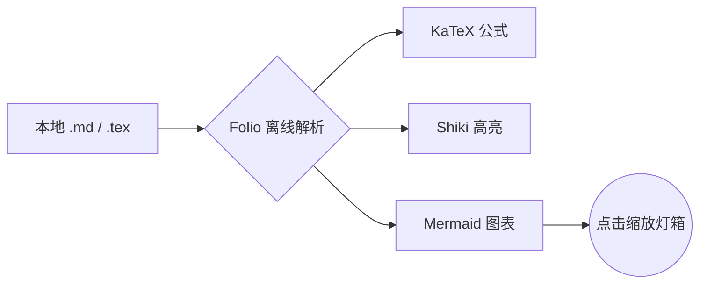

# Folio 排版样张

手稿可以反复修改，阅读不必从头开始。这份样张把一页笔记中常见的文字、公式和变更记录放在同一张活页上。

> 好的排版不是让每一行都引人注目，而是让读者始终知道自己读到了哪里。

## 公式与正文

行内公式 $E=mc^2$ 和 \(a^2+b^2=c^2\) 随正文排列。下式是一份连续分布的归一化示例：

$$
\int_{-\infty}^{\infty} e^{-x^2}\,dx = \sqrt{\pi}
$$

\[
\mathbf{v} = \begin{bmatrix} x \\ y \end{bmatrix}
\]

## 代码与修订

```ts
type Manuscript = { title: string; paragraphs: string[] };

function countParagraphs(document: Manuscript): number {
  return document.paragraphs.length;
}
```

```diff
--- a/manuscript.md
+++ b/manuscript.md
@@ -1,2 +1,2 @@
 # 阅读手记
-一页手稿，只有一个版本。
+一页手稿，可以反复修改。
```

## 提示块

> [!NOTE]
> 这份排版样张不计入最近查阅。

> [!TIP]
> 用正文中的[链接跳到表格](#表格与任务)，再从大纲返回这里。

> [!IMPORTANT]
> 归档时请把文档与它引用的图片放在一起。

> [!WARNING]
> 某段推导暂缺出处，发布前需补上。

> [!CAUTION]
> 不要把还在讨论的结论当成定稿。

## 表格与任务

| 章节 | 状态 | 修订次数 |
| :--- | :--- | ---: |
| 开篇 | 可读 | 2 |
| 论证 | 待补例子 | 3 |
| 附录 | 已校对 | 1 |

- [x] 补齐行内引用
- [x] 对照公式与代码
- [ ] 确认论证中的例子

### 本地插图


### 离线 Mermaid 图表


